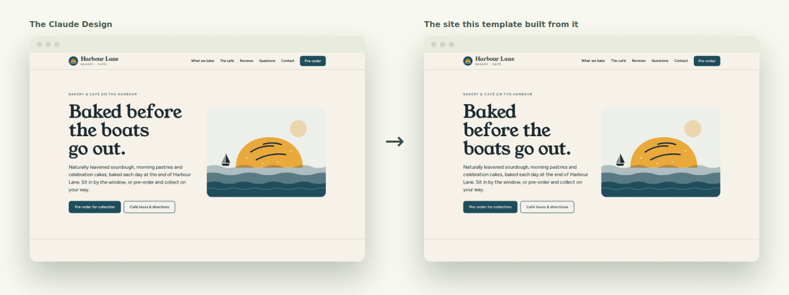
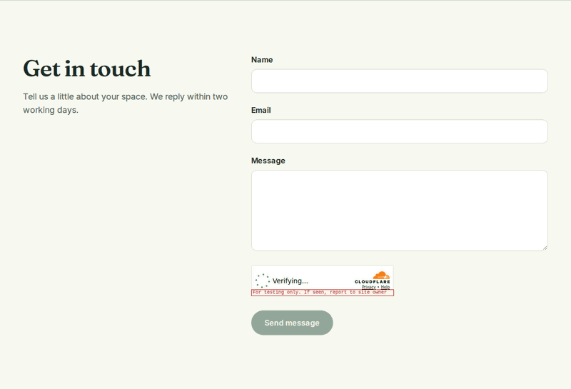

# cloudflare-site-template

[](https://github.com/jleavers/cloudflare-site-template/actions/workflows/ci.yml?query=branch%3Amain)
[](LICENSE)

**A Claude Design handoff in, a fast website with a working contact form out.** This template
turns a design from [Claude Design](https://claude.ai) and a one-page brief into a static site on
Cloudflare's network: 100 on Lighthouse, no client-side framework, a spam-protected contact form
that emails you or posts to Slack or Teams, and optional previews of pull requests.


**[Open the live demo](https://cloudflare-site-template.84cde4841472e658.workers.dev)** · [](https://deploy.workers.cloudflare.com/?url=https://github.com/jleavers/cloudflare-site-template)

## Contents

- [How it works](#how-it-works): the pieces, and what the template guarantees
- [Live demo](#live-demo): what it runs, and why its form sends nothing
- [Quick start](#quick-start): the example site live on your own account in a few minutes
- [Stamp out a site](#stamp-out-a-site): design and brief in, live site out
- [One-off setup](#one-off-setup): Turnstile, email, Cloudflare token
- [Configuration reference](#configuration-reference)
- [Development](#development)
- [No lock-in](#no-lock-in)
- [Security](SECURITY.md) · [Licence](#licence)

## How it works

- **The site** is [Astro](https://astro.build) in static mode with [Tailwind CSS](https://tailwindcss.com):
  plain HTML and CSS in `dist/`, fonts and images self-hosted and optimised, no client framework.
- **The Worker** (`src/worker.ts`) serves `dist/` from Cloudflare's edge and handles one route,
  `POST /api/contact`. Static requests never touch it, so they are free and unlimited.
- **The contact form** loads [Turnstile](https://developers.cloudflare.com/turnstile/) only
  when it scrolls into view, then checks a honeypot, the origin, Turnstile and every field before
  delivering through Resend, Slack or Teams. That logic (`src/contact/`) is Web-standard
  TypeScript with no Cloudflare APIs.
- **CI** checks every change and deploys `main`. Once you [turn previews on](#cloudflare-api-token),
  it also gives each pull request its own preview URL, where the form works and sends nothing.
- **A Claude Code skill** (`/new-site`) rebuilds the pages from a Claude Design handoff, and then
  holds the result to the template's contracts.





**What every site keeps, whatever its design.** The components are yours to rewrite; these are
not, and the tests enforce them (details in [AGENTS.md](AGENTS.md#contracts)):

| | Contract |
|---|---|
| C1 | Design tokens in `global.css`, site facts in `site.ts`, copy in the pages |
| C2 | Fonts and images self-hosted and sized |
| C3 | No client framework; no third-party script but Turnstile |
| C4 | Title, description, canonical and OpenGraph on every page |
| C5 | The contact form's hooks |
| C6 | The form handler uses Web-standard APIs only |
| C7 | Example values and design placeholders never reach a custom domain |

## Live demo

[The live demo](https://cloudflare-site-template.84cde4841472e658.workers.dev) runs the example site from this repository's `main`, on a Cloudflare
account used for nothing else. It uses Turnstile's public test keys and `log` delivery, so the
contact form works end to end and sends nothing. The strip at the top of every page says so. The
strip disappears by itself once a site sets its own URL in `src/config/site.ts`; the example content is replaced by the `new-site` skill.

## Quick start

Three ways to put the example site live on **your own** Cloudflare account, each needing no
Worker secrets (nothing for Turnstile or email delivery). The form works and sends nothing until you configure delivery.

1. **One click:** the **Deploy to Cloudflare** button above. Cloudflare copies this repository
   into your GitHub account, builds it and deploys it.
2. **Use this template** on GitHub, then store the CI token and account ID and push:
   `gh secret set CLOUDFLARE_API_TOKEN --env production` and the same for `CLOUDFLARE_ACCOUNT_ID`,
   in a `production` environment limited to `main`, or as repository secrets on a private Free
   repository ([which token, and where, by plan](#cloudflare-api-token)).
3. **From your machine:** `npm ci`, `npx wrangler login`, `npm run deploy`.

## Stamp out a site

You need: a Claude Design handoff (or an archive or artifact link), the facts in
[`SITE_BRIEF.md`](SITE_BRIEF.md), and [Claude Code](https://claude.ai/code).

1. `gh repo create <site> --template jleavers/cloudflare-site-template --private --clone`
   The new repository's first CI run starts straight away. On a private repository it needs
   Actions minutes or a self-hosted runner (see [Short of GitHub Actions minutes?](#development)),
   otherwise expect a red first run, which is harmless. Dependabot is on for the new repository
   too.
2. Brief Claude Design with [`design/BRIEFING.md`](design/BRIEFING.md), put its design in
   `design/` ([how](design/README.md)) and fill in `SITE_BRIEF.md`.
3. In Claude Code, run `/new-site`. It rebuilds the pages to match the design, then runs every
   check. Review it with `npm run preview`.
4. [One-off setup](#one-off-setup) for the account and domain, if you haven't done it before.
5. First deploy, from your machine: sign in to Cloudflare ([no browser?](#deploying-from-a-machine-without-a-browser)),
   then `npx wrangler secret put TURNSTILE_SECRET_KEY` and `RESEND_API_KEY` (or `WEBHOOK_URL`),
   then `npm run deploy`. Before the first deploy, `secret put` asks whether to create the Worker:
   answer yes, and `npm run deploy` fills it. The deploy attaches your domain, DNS and
   certificate included.
6. Store the CI token and account ID ([where, by plan](#cloudflare-api-token)):
   `gh secret set CLOUDFLARE_API_TOKEN --env production` and the same for `CLOUDFLARE_ACCOUNT_ID`,
   or repository secrets on a private Free repository, then push. From now on every push to
   `main` deploys; pull-request previews are [opt-in](#cloudflare-api-token).

Steps 1, 5 and 6 take under five minutes once step 4 is done. Step 3 depends on the design.

## One-off setup

### Turnstile

Create a widget in the Cloudflare dashboard (Turnstile → Add widget, managed mode), or with
the API. Its hostnames are your domain and `<your-subdomain>.workers.dev`, which covers every
preview. A free widget takes up to ten hostnames. Put the **site key** in
`src/config/site.ts` and the **secret** in `npx wrangler secret put TURNSTILE_SECRET_KEY`.

### Delivery

- **Resend:** verify your sending domain (it adds DNS records), create an API key, and set
  `CONTACT_FROM_EMAIL` to an address on that domain. It may carry a display name, as
  `Example Co. <website@example.com>`; preflight reads the domain from inside the `<…>`.
- **Slack:** create an incoming webhook for a channel.
- **Teams:** create a Workflows webhook ("When a Teams webhook request is received") for a
  channel.

### Cloudflare API token

For CI: My Profile → API Tokens → Create Custom Token with **Account → Workers Scripts → Edit**
and **Account → Account Settings → Read**, limited to one account. That is enough to create and
deploy a workers.dev Worker and to deploy previews. Only **attaching a custom domain** needs more
(Zone → Workers Routes → Write), which is why that first deploy runs from your machine with
`wrangler login` (or a token that has it). A token with Workers Scripts → Edit can change **every** Worker on its account,
so keep the repositories that hold one to yourself.

CI hands the token only to jobs that run no code from the branch or the lockfile. They take
`wrangler.jsonc` and the wrangler version from `main` (for a pull request, from the default
branch by name), deploy what a job without the token built, and always run on GitHub-hosted
runners. That makes `main`'s `wrangler.jsonc` part of what you trust: its `assets.directory`,
`rules` and `tsconfig` steer what wrangler reads and uploads, so review a change to it as you
would a change to `.github/workflows/`. Only the bundle's `worker.js` ships: a Worker whose
bundle has more modules (a `.wasm`, text or data import) fails to deploy until the copy step in
`ci.yml`, and the test that pins it, take them too.

Where you store the token, and who can push to `main`, decide who else can reach it:

- **Public repository (any plan), or private on GitHub Enterprise:** in Settings → Environments,
  create an environment `production` whose deployment branches are limited to `main`, and give it
  the token and account ID as environment secrets:
  `gh secret set CLOUDFLARE_API_TOKEN --env production` and
  `gh secret set CLOUDFLARE_ACCOUNT_ID --env production`. For previews, put the same two secrets
  in an environment `preview` with required reviewers. Then delete the repository-level copies
  (`gh secret delete CLOUDFLARE_API_TOKEN`, and the same for `CLOUDFLARE_ACCOUNT_ID`). Protect
  `main` with a ruleset that requires a pull request (Settings → Rules → Rulesets): every push to
  `main` deploys, running that commit's `scripts/trusted-config.mjs` before wrangler.
- **Private on Pro or Team:** the `production` environment and the ruleset as above. Leave
  previews off: these plans have no required reviewers for a private repository.
- **Private on Free:** there are no environment secrets and no rulesets, so the token stays a
  repository secret (`gh secret set CLOUDFLARE_API_TOKEN`) and `main` stays open to anyone who
  can push. The deploy still runs: its job names `production`, and the repository secret resolves
  there (checked on a private repository). **Anyone who can push to `main` or push a workflow
  change can read the token**, and that includes a coding agent whose token has Contents write.

The jobs that hold the token need GitHub-hosted minutes. A private repository that has used up
its minutes can't deploy from CI that month: deploy with `npm run deploy` from your machine
instead.

**Previews** are off unless you set the repository variable `CI_PREVIEWS` to `true`
(`gh variable set CI_PREVIEWS --body true`). Do that only once the `preview` environment has
required reviewers and holds the token, because a pull request's run uses that pull request's own
workflow file. Each preview then waits for an approval, and so does each deletion of one when
its pull request closes. Previews don't inherit production secrets; don't add any to the
Previews base config. A private site previews locally with `npm run preview` (`log` delivery,
test keys).

**Coding agents:** if an agent can push branches to the repository ([AGENTS.md](AGENTS.md#git-workflow)
lets it), give it an **HTTPS token without workflow permission**: a fine-grained token with
Contents and Pull requests read and write and no Workflows permission, or a classic token without
the `workflow` scope. Don't give it your SSH key. GitHub refuses a workflow change only from a
token that lacks that permission; an SSH key, yours or a deploy key, can push anything. Contents
write can still push to `main` unless a ruleset requires a pull request there, so set one up
where the plan allows (above).

### Deploying from a machine without a browser

`npx wrangler login` prints an OAuth link, but the browser then redirects to
`http://localhost:8976/oauth/callback`, which lands on the browser's machine, not on an SSH
dev box or VM. Two ways round it:

- **Use an API token instead of `wrangler login`.** The [CI token](#cloudflare-api-token) works
  from your terminal for a workers.dev site. Attaching a custom domain also needs
  **Zone → Workers Routes → Write**. `read -s` and `-MaskInput` keep the token off the screen
  and out of shell history.

  bash:

  ```bash
  read -rsp 'Cloudflare API token: ' CLOUDFLARE_API_TOKEN && echo && export CLOUDFLARE_API_TOKEN
  export CLOUDFLARE_ACCOUNT_ID=<account id>
  ```

  PowerShell:

  ```powershell
  $env:CLOUDFLARE_API_TOKEN = Read-Host -MaskInput 'Cloudflare API token'
  $env:CLOUDFLARE_ACCOUNT_ID = '<account id>'
  ```

- **Forward wrangler's callback port** from the machine with the browser:
  `ssh -L 8976:localhost:8976 <host>`, then run `npx wrangler login` in that session and open its
  link locally.

## Configuration reference

| Where | Name | What |
|---|---|---|
| `src/config/site.ts` | `site` | name, title, description, URL, language, navigation, contact, legal, privacy, analytics |
| `src/styles/global.css` | `@theme` | colours, fonts, radii |
| `astro.config.mjs` | `fonts` | font families and weights (self-hosted at build) |
| `wrangler.jsonc` vars | `DELIVERY_PROVIDER` | `resend`, `slack`, `teams` or `log` |
| | `CONTACT_TO_EMAIL`, `CONTACT_FROM_EMAIL` | Resend's recipient and sender |
| | `TURNSTILE_FAIL_OPEN` | `true` lets messages through when Turnstile is unreachable (default `false`) |
| Worker secrets | `TURNSTILE_SECRET_KEY` | always |
| | `RESEND_API_KEY` or `WEBHOOK_URL` | for the provider |
| GitHub secrets | `CLOUDFLARE_API_TOKEN`, `CLOUDFLARE_ACCOUNT_ID` | for CI deploys and previews: in the `production` and `preview` environments, or repository secrets on a private Free repository ([where](#cloudflare-api-token)) |
| GitHub variables | `CI_LINUX_RUNNER` | optional: a self-hosted runner label for the jobs without the token (private repositories only) |
| | `CI_PREVIEWS` | optional: `true` turns on pull-request previews, once the `preview` environment has required reviewers ([why](#cloudflare-api-token)) |

## Development

| Command | Does |
|---|---|
| `npm run dev` | Astro's dev server, pages only |
| `npm run preview` | the whole site and Worker locally, with Turnstile's test keys and `log` delivery |
| `npm run verify` | type check, unit tests, build, contract tests on the build |
| `npm run test:e2e` | the browser tests (Playwright, Chromium) |
| `npm run lighthouse` | the Lighthouse budgets; performance must score 100 |
| `npm run preflight` | is this checkout still the template, or does a built page still have a `[bracketed]` design placeholder? (decides whether a deploy may go ahead; build first) |
| `npm run deploy` | build, preflight, deploy |

`npm run build` downloads the site's fonts from Google Fonts at build time, through the Astro
Fonts API, so building needs network access, while visitors never contact Google.

`npm run preview` never sends a real message. To try real delivery locally, put the settings in
a `.dev.vars` file (gitignored) and run `npx wrangler dev` yourself.

**Pull-request previews**, once [turned on](#cloudflare-api-token), use Cloudflare
[Previews](https://developers.cloudflare.com/workers/previews/): each gets its own URL,
Turnstile's test keys and `log` delivery, and is deleted when the pull request closes. On a Resend site, `wrangler preview` warns that
`CONTACT_TO_EMAIL` and `CONTACT_FROM_EMAIL` are configured for production but not for Previews:
that is intended, because a preview without the addresses cannot send. Leave it.

**Short of GitHub Actions minutes?** CI's checks can run on a self-hosted runner (set
`CI_LINUX_RUNNER`, private repositories only), or you can connect the repository to Cloudflare's
[Workers Builds](https://developers.cloudflare.com/workers/ci-cd/builds/) instead, which builds
on Cloudflare's own minutes. The deploy and preview jobs always run on GitHub-hosted runners,
because they hold the Cloudflare token: with no hosted minutes left, a private repository can't
deploy from CI that month, so deploy with `npm run deploy` from your machine.

## No lock-in

- **The site** is `dist/`: plain HTML, CSS and images. `aws s3 sync dist s3://<bucket>`, or
  any static server (Caddy, Nginx) serves it unchanged.
- **The form handler** is `handleContact(request, env, { fetch })` in `src/contact/handler.ts`:
  Web-standard `Request` in, `Response` out, about 300 lines with no dependencies. On any runtime
  that speaks those APIs it is a one-liner, for example on Deno:
  `Deno.serve((request) => handleContact(request, Deno.env.toObject(), { fetch }))`. On AWS
  Lambda, put it behind a Request/Response adapter, or translate it: it is a pipeline of seven
  plain steps ([spec §7.3](docs/superpowers/specs/2026-10-12-cloudflare-site-template-design.md)).

## Licence

The template is licensed under the [Apache License 2.0](LICENSE). A site you build from it is
yours: its content, design and copy belong to you.
